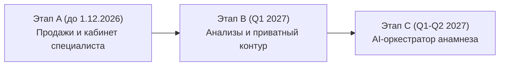
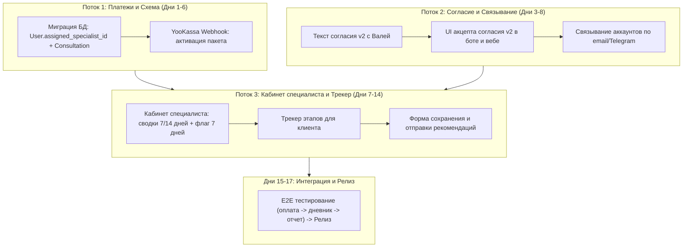

# Архитектурный проект: Specialist Flow (Кабинет специалиста и единый профиль клиента)

**Дата:** 6 ноября 2026 г.  
**Статус:** Черновик для согласования владельцем  
**Базовый принцип:** Главная модель клиента — `User` (создаваемый и обогащаемый в Telegram-боте). Вход: Telegram — основной канал идентификации, email — резервный/веб-канал. Оба привязаны к одной записи `User`.

---

## 1. Связывание аккаунтов и унификация сущностей

### 1.1. Текущее состояние базы данных
- `User` (таблица PostgreSQL, модель Prisma): 21 запись. Хранит всю активность бота (`NutritionLog`, `SleepLog`, `HydrationLog`, `ActivityLog`, биометрию, подписки).
- `auth.users` (схема Supabase Auth): 23 записи. Создаются при веб-авторизации через Magic Link / Email OTP / Telegram Mini App OAuth.
- `profiles`: 0 записей в продакшене. Является устаревшей пустой абстракцией и полностью выводится из эксплуатации в пользу `User`.

### 1.2. Сценарии связывания аккаунтов
1. **Сценарий 1: «Сначала Telegram, потом Email» (основной путь 90%+ пользователей)**
   - Пользователь начинает с Telegram-бота. Создаётся `User` с `telegram_id` и синтетическим `email` вида `tg_<telegram_id>@telegram.vireyou.com`.
   - Пользователь переходит на сайт (например, по ссылке из бота со `start_param` или авторизуется по email для получения разбора на большом экране).
   - Вводит свой реальный email. 
   - **Логика:** Система проверяет `User` по `telegram_id` (через Mini App сессию или токен перехода). При совпадении поле `User.email` обновляется с синтетического на подтверждённый реальный email, а `auth.users.id` линкуется с `User.id`.

2. **Сценарий 2: «Сначала Email, потом Telegram»**
   - Пользователь впервые зашёл на сайт, ввёл email, прошёл тест (например, биовозраст или белковый щит). Создан `auth.users` и `User` с `email` и `telegram_id = null`.
   - Позже нажимает в вебе кнопку «Подключить Telegram-бота» (глубокая ссылка `t.me/vireyou_bot?start=link_<token>`).
   - Бот считывает токен, находит существующего `User` по `id` из токена и проставляет `telegram_id`.

3. **Сценарий 3: Конфликт «Два User на одного человека» (пользователь завёл бота и сайт раздельно)**
   - Пользователь зарегистрировался в Telegram (User A: есть логи еды/сна, нет нормального email).
   - Тот же пользователь зашёл на сайт с email (User B: есть результаты тестов `test_results`, нет Telegram).
   - Пользователь пытается привязать Telegram к сайту или вводит тот же email в боте.
   - **Правило слияния (Merge Protocol):**
     - Основным (Master User) объявляется User A (аккаунт Telegram, где накоплены непрерывные данные дневника).
     - Все дочерние записи из User B перепривязываются на User A (`test_results.user_id = UserA.id`, `AccessPermission.user_id = UserA.id`, `Transaction.user_id = UserA.id`, `Consultation.client_id = UserA.id`).
     - Поле `UserA.email` перезаписывается валидным email из User B.
     - Запись User B архивируется/удаляется.
     - Привязанный `auth.users` (Supabase Auth) перенаправляется на `UserA.id`.

4. **Судьба 23 auth.users vs 21 User:**
   - 2 «лишних» пользователя в `auth.users` — это тестовые/брошенные входы через Supabase, для которых не завершилась инициализация в Prisma.
   - В рамках этапа A проводится разовая сверка: `auth.users`, не имеющие пары в `User`, удаляются либо линкуются к соответствующим `User` по email.

---

## 2. Согласие на обработку медицинских данных v2

### 2.1. Концепция согласия v2
- Версия v1 покрывала только агрегацию базовых привычек (питание, сон, вода, активность).
- Версия v2 расширяет согласие на:
  1. Доступ сертифицированного специалиста к персональным метрикам дневника и результатам анкетирования.
  2. Хранение и сопоставление лабораторных показателей (биомаркеров).
  3. Формирование рекомендаций по образу жизни на основе комплексного анамнеза.
- Текст согласия готовится совместно с юристом / Валей с акцентом на то, что сервис носит информационно-оздоровительный характер (wellness & lifestyle optimization) и не заменяет медицинскую помощь.

### 2.2. Хранение в схеме базы данных
Поля в модели `User`:
- `health_consent_version`: целочисленная версия (1 -> 2).
- `health_consent_given_at`: точный таймстемп принятия (`timestamptz`).
- `adult_confirmed_at`: подтверждение возраста 18+.

### 2.3. Миграция текущих пользователей (v1 -> v2)
- Пользователи, у которых `health_consent_version = 1` или `null`, блокируются от доступа к консультационному флоу до акцепта v2.
- **В Telegram-боте:** При нажатии «Консультация» или вызове меню специалиста бот выводит экран:  
  *«Мы обновили условия конфиденциальности и согласия на ведение специалистом. Ознакомьтесь с новой редакцией [ссылка]»* с кнопкой *«Принимаю условия v2»*.
- **На сайте:** Всплывающий модальный диалог перед экраном оплаты консультации или входом в кабинет.

---

## 3. Этапность реализации

---

### ЭТАП A: Запуск продаж и ручная работа специалиста (Срок: до 01.12.2026)
**Главная цель:** Открыть коммерческий приём оплат и обеспечить специалисту удобный обзор клиентов бота. Загрузку файлов анализов на этапе A **не делаем** (клиент отправляет анализы при необходимости в чат Telegram лично специалисту, либо они обсуждаются на созвоне).

#### 1. Изменения схемы БД (Prisma / PostgreSQL):
- `User`:
  - `assigned_specialist_id String?` — связь со специалистом (FK на `User.id`), переносится из устаревшей таблицы `profiles` (полная реализация Варианта б).
  - Запись и смена `assigned_specialist_id` выполняется **исключительно через Server Action** (с авторизацией `admin`/`specialist`), так как для роли `authenticated` прямая запись в `User` через REST API полностью закрыта политиками RLS и отзывом прав на уровне БД.
  - Разделение прав доступа (`role`) и коммерческого тарифа:
    - Добавление отдельного поля тарифа: `subscription_tier String @default("FREE")` (значения: `FREE`, `STANDARD`, `PRO`).
    - Очистка поля `role`: в `role` остаются только права доступа (`client`, `specialist`, `admin`). Для 3 текущих пользователей со значением `role = 'PRO'` значение переносится в `subscription_tier = 'PRO'`, а `role` приводится к `client`.
  - `health_consent_version Int? @default(1)`
  - `health_consent_given_at DateTime?`
- Вывод таблицы `profiles` из эксплуатации (0 строк в продакшене): архивирование/удаление пустой таблицы после переноса `assigned_specialist_id` в `User`.
- Создание модели `Consultation`:
  - `id String @id @default(uuid())`
  - `client_id String` (FK `User.id`)
  - `specialist_id String` (FK `User.id`)
  - `status String` (`PAID`, `OBSERVATION_7D`, `READY_FOR_REVIEW`, `COMPLETED`, `CANCELLED`)
  - `stage String` (`PAYMENT`, `DIARY_7D`, `SPECIALIST_REVIEW`, `RECOMMENDATION_DELIVERED`)
  - `recommendations_text String? @db.Text` — финальное заключение специалиста
  - `recommendations_sent_at DateTime?`
  - `created_at DateTime @default(now())`
  - `updated_at DateTime @updatedAt`
- Модель `Transaction`: фиксация типа пакета `CONSULTATION_PACKAGE` (сумма, статус YooKassa).

#### 2. Роуты и API:
- `POST /api/payments/create-consultation` — создание платежа YooKassa на пакет консультации.
- `POST /api/payments/webhook` — обработка успешной оплаты: перевод `Consultation.status = 'PAID'`, назначение `assigned_specialist_id`.
- `GET /api/specialist/clients` — список закреплённых клиентов со статусами и метриками.
- `POST /api/specialist/save-recommendation` — сохранение рекомендаций и отправка уведомления клиенту.

#### 3. Экраны:
- **Для клиента (Сайт / Mini App):**
  - Экран оффера консультации с прозрачным описанием ценности и кнопкой оплаты через YooKassa.
  - «Трекер этапов консультации»:
    1. *Оплата подтверждена.*
    2. *Дневник наблюдения (заполнено Х из 7 дней).*
    3. *Анализ данных специалистом.*
    4. *Готовые рекомендации доступны.*
- **Для специалиста (`/[locale]/specialist`):**
  - Таблица клиентов, оплативших пакет.
  - Карточка клиента с отображением:
    - Флаг «7 дней наблюдения» (динамический расчёт: количество дней за последние 14 дней, в которых есть хотя бы 1 запись еды/сна/активности).
    - Агрегированные графики и сводки за 7 и 14 дней (КБЖУ, белок г/кг, средний сон, шаги, вода).
    - Текстовый редактор рекомендаций с кнопкой «Отправить клиенту в бот и кабинет».

#### 4. Что проверить перед запуском (Checklist):
- [ ] Оплата тестовой и боевой картой через YooKassa с возвратом на страницу трекера.
- [ ] Корректный подсчёт «7 дней с записями» (не календарных дней от оплаты, а именно дней с фактом логов).
- [ ] Доставка уведомления клиенту в Telegram о готовности рекомендаций.
- [ ] Доступ к экрану специалиста защищён проверкой `User.role IN ('specialist', 'admin')`.

#### 5. Оценка трудоёмкости:
- 10–12 рабочих дней (укладывается в срок до 25 ноября для финального тестирования).

---

### ЭТАП B: Загрузка лабораторных анализов и приватный контур (Q1 2027)
**Главная цель:** Безопасное хранение медицинских файлов (PDF/сканы), OCR-распознавание, совместная работа «AI-черновик → специалист».

#### 1. Изменения схемы:
- Модель `MedicalDocument`:
  - `file_path String` (путь в приватном S3/Supabase Storage бакете).
  - `mime_type String`, `file_size Int`.
  - `ocr_status String` (`PENDING`, `PARSED`, `FAILED`).
  - `extracted_markers Json?` — сырые биомаркеры из документа.
- Модель `SpecialistDraft`:
  - `consultation_id String`.
  - `ai_generated_draft String @db.Text` — черновик гипотез от нейросети.
  - `specialist_edited_text String @db.Text` — правки специалиста.
  - `version Int`.
- Модель `AuditLog` (Журнал доступа к медданным):
  - `actor_id String`, `target_user_id String`, `action String`, `ip_address String`, `timestamp DateTime`.

#### 2. Инфраструктура и безопасность:
- Бакет `medical-vault` переводится в режим **Strict Private** (доступ анонимных пользователей и прямые публичные URL запрещены).
- Генерация короткоживущих Signed URL (TTL 15 минут) только после проверки прав текущей сессии через backend.
- Функция «Удалить все мои медицинские данные» (Right to be forgotten) — физическое удаление файлов и каскадное удаление строк биомаркеров.

#### 3. Оценка трудоёмкости:
- 15–18 рабочих дней.

---

### ЭТАП C: Интеллектуальный ассистент-анамнез и база знаний (Q1–Q2 2027)
**Главная цель:** Перенос единого оркестратора бота на веб-кабинет, интеллектуальный опрос жалоб и подбор клинических карточек для специалиста.

#### 1. Изменения схемы:
- Таблица `knowledge_cards`:
  - Поле `audience String @default('client')` (`client` | `specialist`).
  - Карточки с `audience = 'specialist'` содержат референсы клинических протоколов, уровни доказательности, дифференциальные маркеры.
  - Поле `tags String[]` для тематического таргетинга.

#### 2. Возможности:
- Интерактивный чат-сбор анамнеза в веб-интерфейсе, работающий на том же стэке LLM-оркестрации, что и Telegram-бот.
- Автоматическая подсказка специалисту релевантных карточек знаний при просмотре аномальных биомаркеров клиента.

#### 3. Оценка трудоёмкости:
- 20 рабочих дней.

---

## 4. Критический путь этапа A до 01.12.2026 (Сегодня: 06.11.2026)

До дедлайна осталось **17 рабочих дней (24 календарных дня)**.

### Что параллелится:
1. **Разработка интеграции YooKassa и моделей БД** (Backend) ведётся одновременно с **составлением юридического текста согласия v2** (Валя / юрист).
2. **Вёрстка экрана специалиста (сводки 7/14 дней)** параллелится с **экраном клиентского трекера этапов**.

### Что режем в первую очередь при нехватке времени (Деградация фичей):
1. **Первый кандидат на срез:** Автоматическое связывание конфликтующих дубликатов User (если у клиента раздельный email и Telegram — привязка делается вручную через саппорт/админку по запросу).
2. **Второй кандидат на срез:** Сложные интерактивные графики в кабинете специалиста заменяются табличной сводкой средних значений за 7/14 дней.
3. **Что резать КАТЕГОРИЧЕСКИ НЕЛЬЗЯ:**
   - Оплату через YooKassa с выдачей чека.
   - Проверку роли специалиста (безопасность).
   - Фиксацию факта принятия согласия v2.
   - Базовый просмотр данных дневника (без этого специалист не сможет выполнить услугу).

---

## 5. Риски, требующие решения владельца (Вопросы без готовых выводов)

> [!WARNING]
> Ниже приведены принципиальные правовые, финансовые и регуляторные вопросы, по которым владелец продукта должен принять решение до запуска платного сервиса.

1. **Локализация персональных данных граждан РФ (152-ФЗ):**
   - Текущая база данных PostgreSQL (Supabase) физически размещена в регионе `eu-central-1` (Франкфурт, Германия).
   - *Вопросы:* Допустимо ли с точки зрения риск-профиля проекта начинать приём платных клиентов из РФ на зарубежной инфраструктуре? Требуется ли первичное сохранение персональных данных (ФИО, телефон, email) в РФ-контуре с последующей репликацией, либо проект работает в юрисдикции иностранного юрлица?

2. **Данные о здоровье как специальная категория персональных данных (ст. 10 152-ФЗ):**
   - Дневники питания, биомаркеры, сведения о сне и самочувствии подпадают под специальную категорию ПДн.
   - *Вопросы:* Достаточно ли простой электронной подписи (чекбокса на сайте / кнопки в Telegram-боте), либо регулятор потребует верифицированного согласия (например, через подтверждённый телефон / Госуслуги / усиленную ЭП)? Каковы последствия при проверках Роскомнадзора?

3. **Юридическая структура продавца и кассовые чеки (54-ФЗ):**
   - Платежи будут приниматься через YooKassa.
   - *Вопросы:* Кто выступает продавцом в договоре с YooKassa: российское юридическое лицо (ООО), ИП на УСН/патенте или самозанятый? Подключена ли онлайн-касса (Атол, МойСклад, OrangeData и т.п.) для автоматической фискализации и отправки чеков в ФНС в момент списания средств?

4. **Формулировка услуги и риски признания медицинской деятельностью (ст. 2, 323-ФЗ):**
   - Любая консультация по здоровью без медицинской лицензии несёт риск претензий Росздравнадзора.
   - *Вопросы:* Как точно именуется пакет в оферте и чеке? (Рекомендуемые формулировки: *«Информационно-консультационные услуги по оптимизации образа жизни и режима питания»* vs запрещённые: *«Консультация врача-нутрициолога»*, *«Диагностика заболеваний»*, *«Назначение лечения»*). Содержит ли оферта явный дисклеймер: *«Не является медицинской услугой, не заменяет очный приём лечащего врача»*?

5. **Политика возвратов (Refund Policy):**
   - Клиент оплатил консультацию, но отказался вести дневник 7 дней либо остался недоволен рекомендациями.
   - *Вопросы:* В какой момент услуга считается оказанной в полном объёме? Предусмотрен ли частичный возврат, если клиент передумал до подготовки рекомендаций специалистом? Кто несёт комиссионные расходы эквайринга при возврате?

